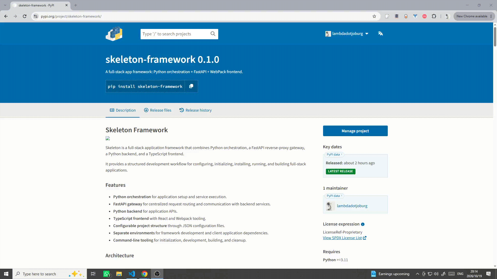
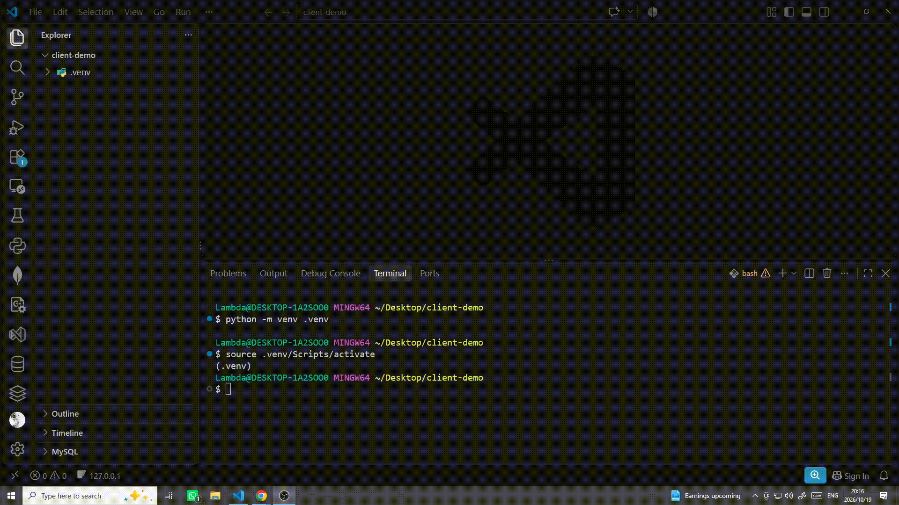
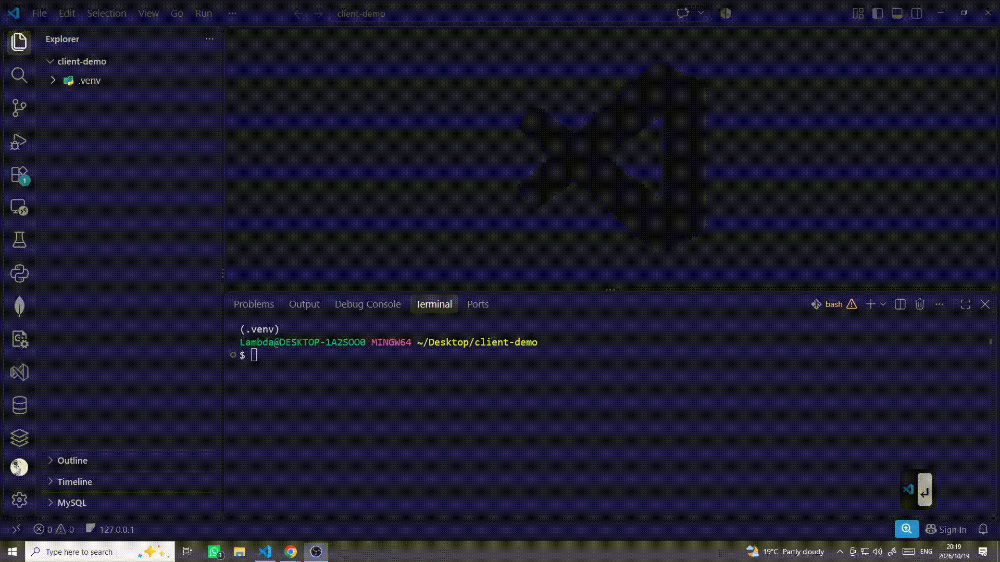
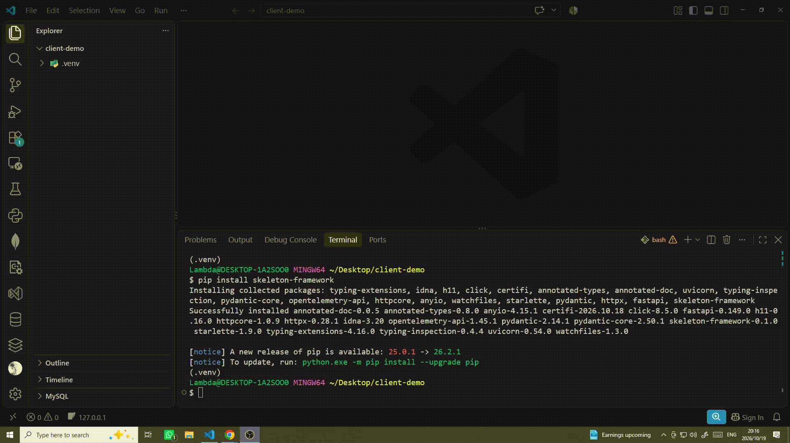
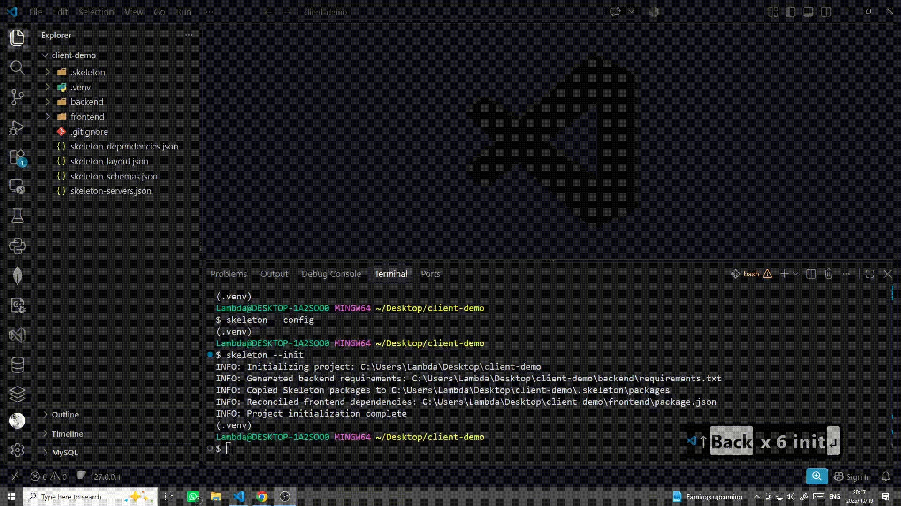
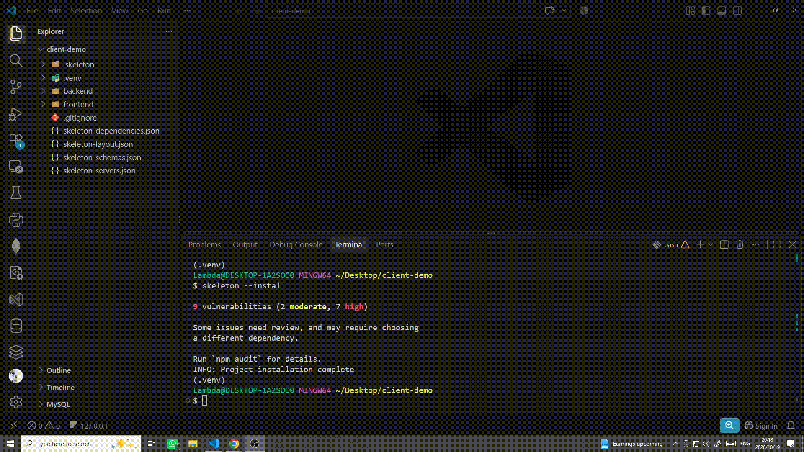
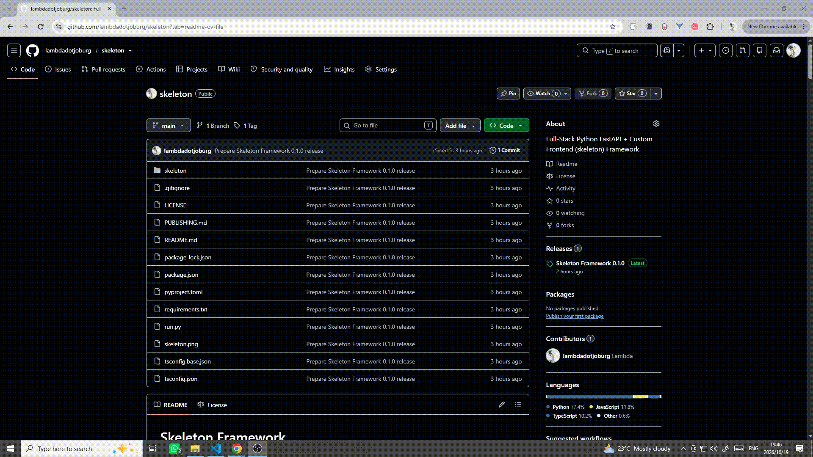
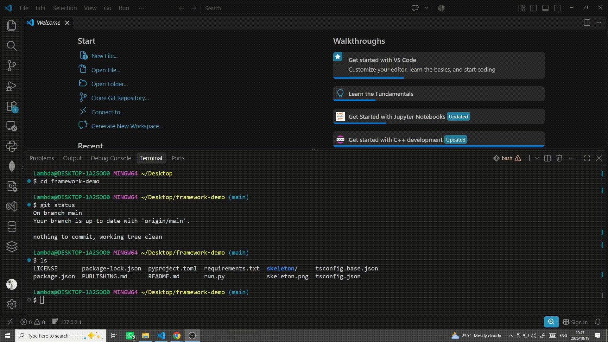
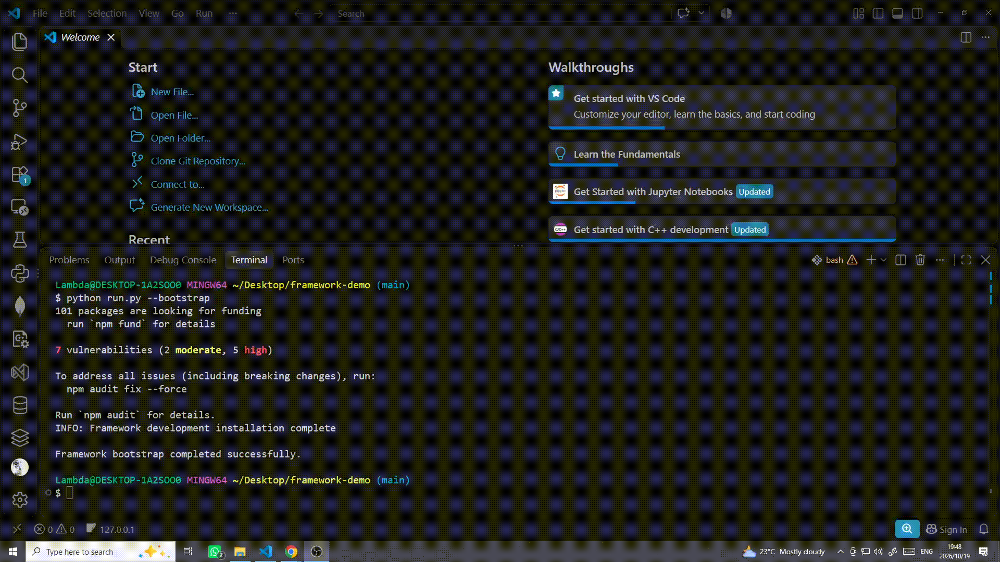

# Skeleton Framework


Skeleton is a full-stack application orchestration framework that combines
Python orchestration, a FastAPI reverse-proxy gateway, a Python backend & TypeScript frontend.

It provides a structured development workflow for configuring,
initializing, installing, running & building full-stack applications.

## Features

- **Python orchestration** for application setup and service execution.
- **FastAPI gateway** for centralized request routing and communication with backend services.
- **Python backend** for application APIs.
- **TypeScript frontend** with Webpack tooling.
- **Configurable project structure** through JSON configuration files.
- **Separate environments** for framework development and client application dependencies.
- **Command-line tooling** for initialization, development, building, and cleanup.

## Architecture

Skeleton separates the application into cooperating layers:

| Layer                     | Technology  |
|---------------------------|-------------|
| Orchestration and CLI     | Python      |
| Gateway and backend APIs  | FastAPI     |
| HTTP server               | Uvicorn     |
| HTTP communication        | HTTPX       |
| Frontend                  | TypeScript  |
| Frontend bundling         | Webpack     |
| Development file watching | watchfiles  |
| Dependency management     | pip and npm |

The gateway provides a central entry point for browser requests and coordinates communication between the frontend and backend.

## Requirements

Before getting started, install:

- Python 3.11 or later & pip.
- Node.js and npm.

## Installation

Install Skeleton from PyPI:

```bash
python -m pip install skeleton-framework
```





The installed Python distribution provides the `skeleton` command.

## Quickstart

Create or enter an empty directory for your application:

```bash
mkdir my-app
cd my-app
```

Configure the project, initialize its files, and install its dependencies:

```bash
skeleton --quickstart
```



This combines the configuration, initialization, and installation stages.

To run the application:

```bash
skeleton --start
```

Follow the terminal output for service startup information and open the application at the configured local address.

## Client project workflow

Skeleton also exposes the individual stages when you want to configure the application before installing dependencies.

### 1. Generate configuration

```bash
skeleton --config
```



This generates the project's configuration files:

- `skeleton-layout.json` — defines the application layout.
- `skeleton-dependencies.json` — declares frontend and backend dependencies.
- `skeleton-schemas.json` — provides schema configuration.
- `skeleton-servers.json` — defines server configuration.
- `.gitignore` — establishes ignore rules for generated files.

Review and customize these files before initialization if necessary.

### 2. Initialize the project

```bash
skeleton --init
```


Initialization creates the configured frontend and backend structure from the framework's templates, prepares dependency manifests, and configures the local frontend tooling packages.

### 3. Install dependencies

```bash
skeleton --install
```



This installs frontend dependencies using npm and backend Python dependencies into the backend's `.venv` environment.

### 4. Start services

```bash
skeleton --start
```

You can also explicitly select services:

```bash
skeleton --start frontend gateway --open
```



The selected services and runtime options determine which processes are started.

## Frontend commands

Run these commands from the client project root:

| Command              | Purpose                                                                  |
|----------------------|--------------------------------------------------------------------------|
| `skeleton --serve`   | Start the frontend development server.                                   |
| `skeleton --build`   | Build the frontend for distribution.                                     |
| `skeleton --preview` | Run the configured frontend preview script.                              |
| `skeleton --clean`   | Remove generated frontend build artifacts.                               |
| `skeleton --purge`   | Remove frontend build artifacts and disposable development dependencies. |

These commands invoke the corresponding scripts defined in the configured frontend directory's `package.json`.

## Default development ports

The default development configuration uses the following ports:

| Service                     | Address                 |
|-----------------------------|-------------------------|
| Gateway / reverse proxy     | `http://127.0.0.1:8000` |
| Backend API                 | `http://127.0.0.1:8080` |
| Frontend development server | `http://127.0.0.1:3000` |

The gateway is the normal entry point for browser access.

For example, the test API endpoint can be accessed through:

```text
http://127.0.0.1:8000/api/test
```

The corresponding backend endpoint may be available directly at:

```text
http://127.0.0.1:8080/test
```

Actual routes depend on the application's server and gateway configuration.

## Project structure

A generated client project follows the configured layout.

A typical structure is:

```text
my-app/
├── skeleton-layout.json
├── skeleton-dependencies.json
├── skeleton-schemas.json
├── skeleton-servers.json
├── frontend/
├── backend/
└── .skeleton/
```

The frontend contains the TypeScript application and its npm tooling.

The backend contains the Python application and its own virtual environment.

The `.skeleton/` directory holds local framework tooling and generated assets.

The exact structure depends on the project's configuration.

## Cleanup

Run `skeleton --clean` to remove generated frontend build outputs.

Run `skeleton --purge` if you want to remove the generated build outputs & disposable frontend development dependencies.

**Warning:**

Purging is destructive

It may remove `node_modules`, lockfiles, and generated local tooling artifacts.

Dependencies may need to be installed again.

## Troubleshooting

### The command is not found

Confirm that Skeleton is installed in the Python environment whose scripts directory is available on your terminal's `PATH`.

```bash
python -m pip show skeleton-framework
```

### Frontend or backend dependencies are missing

From the client project root, run:

```bash
skeleton --install
```

If the project has not yet been initialized, run `skeleton --config` followed by `skeleton --init` first.

### Application startup fails

Check that:

- The project has been configured and initialized `skeleton-layout.json`
- Dependencies have been installed `skeleton-dependencies.json`
- The selected services are included in the startup command.
- The required ports are available `skeleton-servers.json`.
- The server configuration matches the configured project layout.

### Framework tooling packages are missing

If working directly from the framework source repository,
run the framework's packaging command before initializing
a client project:

```bash
python run.py --pack
```

## Framework development

These commands are intended for contributors working in the Skeleton framework source repository, not ordinary client projects.

Initialize the framework development environment:

```bash
python run.py --bootstrap
```

Prepare the framework's distributable tooling packages:

```bash
python run.py --pack
```

Build the Python distribution:

```bash
python run.py --build
```

Additional development and cleanup commands are available:

```bash
python run.py --init
python run.py --install
python run.py --clean
python run.py --purge
```

The framework's Python development environment and root `requirements.txt` are separate from the environments created for client applications.

## Project status

Skeleton is an experimental framework under active development. Its goal is to provide a clear, reproducible foundation for full-stack application development while keeping configuration, orchestration, frontend tooling, and backend services independently manageable.

## Framework development

These commands are intended for contributors working in the Skeleton framework source repository, not ordinary client projects.

To get the skeleton framework onto your local machine for development, clone:

[Skeleton Github repository](https://github.com/lambdadotjoburg/skeleton.git)



### Initialize the framework development environment

```bash
python run.py --bootstrap
```



This combines `--init` and `--install` to initialize and install the framework's development environment.

### Build the framework distribution

```bash
python run.py --dist
```



This combines `--pack` and `--build`.

It prepares the distributable tooling packages
& builds the Python distribution in `dist/`.

### Cleanup

```bash
python run.py --clean
python run.py --purge
```

The framework's Python development environment and root `requirements.txt` are preserved by framework cleanup.

## Framework Developer: Testing a Local Installation

Use this workflow to test the locally built `skeleton-framework` distribution in a separate client project.

This verifies that the installed package works independently of the framework source repository.

### 1. Build the distribution

From the framework repository root:

```bash
python run.py --dist
```

The generated wheel will be located in the framework's `dist/` directory.

### 2. Create a separate test project

From the framework repository root, create a sibling directory outside the framework source tree:

```bash
mkdir -p ../skeleton-test-project
cd ../skeleton-test-project
```

### 3. Create and activate the test environment

```bash
python -m venv .venv
source .venv/Scripts/activate
```

On macOS or Linux, use:

```bash
source .venv/bin/activate
```

### 4. Install the locally built wheel

From the test project directory:

```bash
python -m pip install --force-reinstall ../framework/dist/skeleton_framework-0.1.2-py3-none-any.whl
```

Adjust the relative path, wheel filename & version to match your framework checkout and build output.

The `--force-reinstall` option reinstalls the wheel even if that version is already present.

`--no-deps` prevents pip from reinstalling the package's dependencies.

Use this option only when those dependencies are already available in the environment, otherwise, omit `--no-deps`.

### 5. Verify the installation

```bash
python -m pip show skeleton-framework
python -m pip show -f skeleton-framework
```

The first command displays the installed distribution's metadata. The second lists its installed files.

### 6. Test the installed CLI

From the test project root, run the complete client setup:

```bash
skeleton --quickstart
```

Then start the application:

```bash
skeleton --start
```

Alternatively, test the individual setup stages:

```bash
skeleton --config
skeleton --init
skeleton --install
skeleton --start
```

You can also test the remaining client commands:

```bash
skeleton --serve
skeleton --build
skeleton --preview
skeleton --clean
skeleton --purge
```

### 7. Test framework changes

Whenever you modify the framework, rebuild the distribution from the framework repository:

```bash
python run.py --dist
```

Then reinstall the newly built wheel in the test project's virtual environment using the installation command above.

This workflow lets you test packaging, bundled tooling, configuration files, templates,
& CLI behavior without running the client project directly from the framework source tree.

**Important:**

The framework development environment and the test project's `.venv` are independent.

Install the locally built wheel into the test environment
& run the client commands from the test project directory.

## Licence

Skeleton Framework is proprietary software. Copyright © 2026 lambdadotjoburg. All rights reserved.

The source code is publicly available for inspection, but public availability
does not grant unrestricted rights to use, modify, or redistribute the framework.

Personal learning, educational activities, and non-commercial experimentation
are permitted under the terms of the root [LICENSE](./LICENSE) file.

Commercial use requires a separate paid licence from the copyright holder.
Redistribution requires prior written permission.

Third-party dependencies remain subject to their respective licences.

For commercial licensing, redistribution requests, or other permissions,
contact [lambdadotjoburg@gmail.com](mailto:lambdadotjoburg@gmail.com).

See the [LICENSE](./LICENSE) file for the complete terms.
