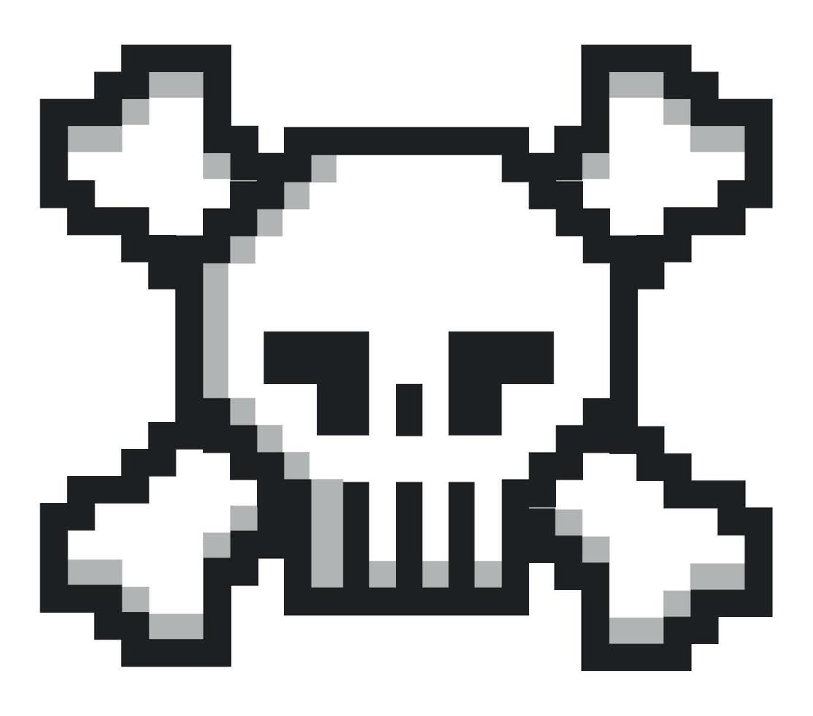

# Skeleton Framework



Skeleton is a full-stack application orchestration framework
that combines Python orchestration, a FastAPI reverse-proxy gateway,
a Python backend, and a TypeScript frontend.

It provides a structured development workflow for configuring,
initializing, installing, running, and building full-stack applications.

Skeleton supports multiple frontend profiles and manages the development
environments and tooling required by each application component.

## Features

- **Python orchestration** for project configuration, initialization, dependency installation and service execution.
- **FastAPI gateway** for centralizing request routing and communication with backend services.
- **Python backend** for application APIs.
- **Multiple frontend profiles** supports Vanilla TypeScript, React, SolidJS, Vue, and Svelte.
- **Webpack tooling** for frontend development and production builds.
- **JSON-based configuration** for project metadata, structure, dependencies, schemas, servers, etc.
- **Command-line interface** for project management, development, versioning, distribution, and cleanup.

## Architecture

Skeleton separates the application into cooperating layers:

| Layer                     | Technology  |
|---------------------------|-------------|
| Orchestration and CLI     | Python      |
| Gateway                   | FastAPI     |
| Backend APIs              | FastAPI     |
| HTTP server               | Uvicorn     |
| HTTP communication        | HTTPX       |
| Frontend                  | TypeScript  |
| Frontend bundling         | Webpack     |
| Development file watching | watchfiles  |
| Dependency management     | pip and npm |

The gateway provides a central entry point for browser requests
and coordinates communication between the frontend and backend.

## Default Development Ports

The default development configuration uses the following ports:

| Service                     | Address               |
|-----------------------------|-----------------------|
| Gateway / reverse proxy     | http://127.0.0.1:8000 |
| Backend API                 | http://127.0.0.1:8080 |
| Frontend development server | http://127.0.0.1:3000 |

The gateway is the normal entry point for browser access.

For example, the index API endpoint can be accessed through:

```text
http://127.0.0.1:8000/api/
```

The corresponding backend endpoint may be available directly at:

```text
http://127.0.0.1:8080/
```

Actual routes depend on the application's server and gateway configuration.

## Installation

### 1. Requirements

Before getting started, install:

- Python 3.11 or later & pip.
- Node.js & npm.

### 2. .venv

It is recommended to create and activate a Python virtual environment before installing Skeleton.

From your project directory, run:

```bash
python -m venv .my-venv
```

Activate the environment using the command for your shell:

**Windows CMD**

```bat
.my-venv\Scripts\activate.bat
```

**Windows PowerShell**

```powershell
.\.my-venv\Scripts\Activate.ps1
```

**Git Bash**

```bash
source .my-venv/Scripts/activate
```

On **macOS / Linux** do:

```bash
source .my-venv/bin/activate
```

### 3. pip installation

Install Skeleton from PyPI:

```bash
python -m pip install skeleton-framework
```

The installed Python distribution provides the `skeleton` command.

## Quickstart

Create or enter an empty directory for your application:

```bash
mkdir my-app
cd my-app
```

Use the `quickstart` operation to configure & initialize
a client project & install its dependencies, for example:

```bash
skeleton --quickstart --profile solid
```

The frontend profile is optional.

If omitted, Skeleton uses the default Vanilla TypeScript profile:

```bash
skeleton --quickstart
```

To run the application:

```bash
skeleton --start
```

Follow the terminal output for service startup information
and open the application at the configured local address.

## Workflow

The [`--quickstart`](#quickstart) command combines `--config`, `--init` & `--install`.

For more control, skeleton exposes each command separately for better workflow.

### 1. Configure

```bash
skeleton --config --profile <profile>
```

Generates the project configuration files using the selected frontend profile.

Review and customize the configuration before continuing, if necessary.

### 2. Initialize

```bash
skeleton --init
```

Creates the application structure
from the framework's boilerplate
& prepares the frontend & backend components.

### 3. Install

```bash
skeleton --install
```

Installs frontend dependencies using npm
& backend Python dependencies into
the backend virtual environment.

### 4. Start

```bash
skeleton --start
```

Starts the configured application services.

## Command-Line Interface

### Help

Display available commands:

```bash
skeleton --help
```

Display help for a specific command:

```bash
skeleton --help --<command>
```

### Project inspection

Inspect the project directory structure:

```bash
skeleton --tree
```

Control the displayed depth:

```bash
skeleton --tree --depth 5
```

Inspect Skeleton documentation:

```bash
skeleton --readme
```

Display a specific documentation section:

```bash
skeleton --readme --section architecture
```

Write documentation to a file/output:

```bash
skeleton --readme --write README.md
```

Or write a documentation section to a file/output:
```bash
skeleton --readme --section architecture --write ARCHITECTURE.md
```

### Common Flags

Most commands support additional execution flags:

| Flag        | Purpose                                         |
|-------------|-------------------------------------------------|
| `--dry`     | Previews an operation without applying changes. |
| `--verbose` | Displays additional execution information.      |

Flags are command-specific. Use `--help` to inspect their availability.

### Lifecycle Commands

Manage generated project distributions and build artifacts:

| Command            | Purpose                                     |
|--------------------|---------------------------------------------|
| `skeleton --dist`  | Builds the client distribution.             |
| `skeleton --purge` | Removes generated build artifacts.          |

`--purge` is destructive & will remove all build artifacts
as listed in `config/skeleton-project.json`, including `node_modules`.

## Project Structure

A client project consists of three main directories:

- `config/` - project and service configuration files.
- `backend/` - Python application and API.
- `frontend/` - TypeScript application and static assets.

The project root also contains its `README.md` and `.gitignore` files.

Dependency installation creates a backend `.venv/` and frontend `node_modules/` directory.

The exact structure depends on the selected frontend profile and project configuration.

Optional VS Code settings are generated in `.vscode/`.

To generate the optional `.vscode` settings for mypy support, run:

```bash
skeleton --vscode --feature mypy
```

To generate the optional `.vscode` settings for markdown support, run:

```bash
skeleton --vscode --feature markdown
```

## Framework Development

### Installation & Setup

Clone the repository and enter its directory:

```bash
git clone https://github.com/lambdadotjoburg/skeleton.git
cd skeleton
```

Follow the [Installation](#installation) instructions
to create and activate a virtual environment.

Install the framework in editable mode with development dependencies:

```bash
python -m pip install --upgrade pip
python -m pip install -e ".[dev]"
```

Editable installation allows framework source
changes to take effect without reinstalling the package.

### Development Commands

Framework development commands are run from the repository root using `python run.py`.

| Command                 | Purpose                                 |
|-------------------------|-----------------------------------------|
| `python run.py --dist`  | Builds the framework distribution.      |
| `python run.py --demo`  | Creates a demo project & installs dist. |
| `python run.py --purge` | Removes framework build artifacts.      |

To specify a demo project location:

```bash
python run.py --demo --target path/to/demo/project
```

The demo operation creates the project directory,
including its `.venv` environment, and installs
the framework dist into that environment.

## Versioning

Use `--bump` to update the project version using semantic versioning.

The `--major`, `--minor`, and `--patch` options accept an optional integer.

If omitted, the selected component increments by one.

```bash
skeleton --bump --major
skeleton --bump --minor 4
skeleton --bump --patch 2
```

Version components follow these rules:

- **Major:** Updates the major component, resets minor & patch to zero.
- **Minor:** Updates the minor component, resets patch to zero.
- **Patch:** Updates only the patch component.

Negative values decrement the selected component,
provided the result remains positive.

Otherwise, that component is set to zero.
Version components never become negative.

For example:

```bash
skeleton --bump --patch -2
```

Decrements the patch component by two,
or sets it to zero if the result would be zero or negative.

Use `--dry` to preview the proposed version without modifying `pyproject.toml`:

```bash
skeleton --bump --patch --dry
```

Add `--verbose` for additional execution information:

```bash
skeleton --bump --patch --dry --verbose
```

The operation updates the relevant files:
- the framework's `pyproject.toml` in framework development mode
- the backend's `pyproject.toml` + `package.json` in a client project.

## Publish

Install or update Twine & validate the generated artifacts:

```bash
python -m pip install --upgrade twine
python -m twine check dist/*
```

Upload the distribution to TestPyPI first:

```bash
python -m twine upload --repository testpypi dist/*
```

After verifying the TestPyPI installation, upload the **same artifacts** to PyPI:

```bash
python -m twine upload dist/*
```

Use the appropriate API token when prompted. TestPyPI and PyPI require separate credentials.

Never commit API tokens or other publishing credentials to the repository.

Do not rebuild or modify the distribution between the TestPyPI and PyPI uploads.

## Project Status

Skeleton is an experimental framework under active development.

Its goal is to provide a clear, reproducible foundation for full-stack
application development while keeping configuration, orchestration,
frontend tooling, and backend services independently manageable.

## TODO

### 1. Operational Improvements

- [ ] Explore combining `--dist` and `--preview` into a single operation.

### 2. Gateway Server updates

- [ ] Implement WebSocket support in the reverse-proxy gateway.

### 3. Release Validation

- [ ] Build and install the framework distribution in a demo project.
- [ ] Test the installed distribution using the standard client workflow.
- [ ] Perform integration testing before publishing releases through Hatch/Twine.

## Licence

Skeleton Framework is proprietary software. Copyright © 2026 lambdadotjoburg.
All rights reserved.

The source code is publicly available for inspection, but public availability
does not grant unrestricted rights to use, modify, or redistribute the framework.

Personal learning, educational activities, and non-commercial experimentation
are permitted under the terms of the root [LICENSE](./LICENSE) file.

Commercial use requires a separate paid licence from the copyright holder.
Redistribution requires prior written permission.

Third-party dependencies remain subject to their respective licences.

For commercial licensing, redistribution requests, or other permissions,
contact [lambdadotjoburg@gmail.com](mailto:lambdadotjoburg@gmail.com).

See the [LICENSE](./LICENSE) file for the complete terms.
